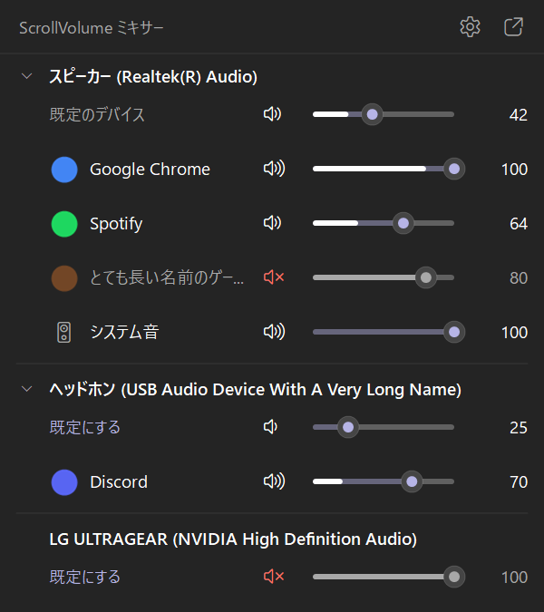
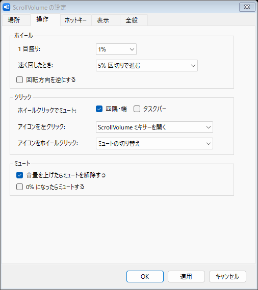

# ScrollVolume

[English](README.md) | **日本語**

画面の四隅・端、タスクバー、トレイのアイコンの上でマウスホイールを回すと、音量を変えられる Windows 用の常駐ツールです。
トレイには今の音量を数字で表示します。

[](https://github.com/megane2501h/ScrollVolume/releases/latest/download/ScrollVolume.zip)

https://github.com/user-attachments/assets/cadb15d4-4feb-4d24-9001-939344190d28



## 特長
- **画面のふちならどこでもホイール** – 四隅・端・タスクバー・トレイのアイコン。小さなスライダーを狙う必要はありません。
- **細かく、速く** – ゆっくり回すと 1% ずつ、速く回すと 5% 区切りで進みます（37 → 40 → 45 → 50%）。
- **ホイールクリックでミュート。**
- **ScrollVolume ミキサー** – すべての再生デバイスと、音を出しているアプリを 1 つの画面に。メーターで、どこから音が出ているかが一目で分かります。既定の再生デバイスもワンクリックで切り替え。
- **ホットキー** – 音量の上げ下げ、ミュートの切り替え、ミキサーを開く、再生デバイスの切り替え。
- **ゲームの邪魔をしない** – 全画面のゲーム中はマウスに反応せず、音量バーも出しません（ホットキーは使えます）。
- **ライト／ダーク** – Windows のテーマに合わせます。日本語・英語の画面。
- **小さく、置くだけ** – 約 220 KB の `.exe` 1 つ。インストーラーも追加のランタイムも不要です。

## ダウンロードと起動
1. [最新のリリース](https://github.com/megane2501h/ScrollVolume/releases/latest)から **[ScrollVolume.zip](https://github.com/megane2501h/ScrollVolume/releases/latest/download/ScrollVolume.zip)** をダウンロードします。
2. 書き込みできるフォルダー（例: `ドキュメント\ScrollVolume`）に展開します。設定は `.exe` と同じフォルダーに保存されます。
3. `ScrollVolume.exe` を起動すると、トレイに音量の数字が出ます。

> **「Windows によって PC が保護されました」と出たら:** `.exe` にコード署名が無いため、初回は SmartScreen の警告が出ることがあります。
> **詳細情報 → 実行** で起動できます。ソースから[自分でビルド](#ビルド)することもできます。

**動作環境:** Windows 10 / 11（Windows に入っている .NET Framework 4.x を使います）

## 使い方
| 場所 | 操作 | 動作 |
|---|---|---|
| 四隅・端・タスクバー・トレイのアイコン | ホイール | 音量を変える |
| 四隅・端 | ホイールクリック | ミュートの切り替え |
| トレイのアイコン | 左クリック | ScrollVolume ミキサーを開く |
| トレイのアイコン | ホイールクリック | ミュートの切り替え |
| トレイのアイコン | 右クリック | メニュー（音量・ミュート・再生デバイス・設定など） |

### ScrollVolume ミキサー
- 行の上でホイール＝そのデバイス・アプリの音量、ホイールクリック＝ミュート
- 「既定にする」で既定の再生デバイスを切り替え
- 右上のボタンでウィンドウ表示に（大きさの変更・最前面に固定ができます）

## 設定
トレイのアイコンを右クリック →「ScrollVolume の設定」。



- **場所** – 反応する四隅・端とその範囲、タスクバーで修飾キー（Ctrl / Shift / Alt）を必要にするか
- **操作** – 1 目盛りの変化量、速く回したときの動作、回転方向、ホイールクリック・アイコンのクリックの動作
- **ホットキー** – 欄を選んでキーを押すだけ
- **表示** – トレイのアイコンの見た目（数字／数字（背景あり）／バー）、文字色、音量バー
- **全般** – Windows の起動時に開始、管理者として実行、ゲーム中の動作、言語

設定は `.exe` と同じフォルダーの `ScrollVolume.ini` に保存されます。

**管理者として実行する:** 管理者として動いているアプリ（タスク マネージャーや一部のゲーム）の上では、Windows の仕様で通常のアプリにマウス操作が届きません。そうした画面の上でもホイールを使いたいときにオンにします。タスク スケジューラにタスクを登録し、毎回 UAC の確認画面を出さずに管理者として起動します。

## アンインストール
1. 設定で「Windows の起動時に開始する」と「管理者として実行する」をオフにします（自動起動の登録とタスクが消えます）。
2. トレイのメニューから「終了」し、フォルダーごと削除します。

## ビルド
```powershell
.\build.ps1
```
Windows に入っている .NET Framework 4.x の `csc.exe` を使います（追加のインストールは不要）。
ScrollVolume を起動中なら、別のファイルに出力します: `.\build.ps1 -Out .\out\ScrollVolume.exe`

### テスト
```powershell
Start-Process .\ScrollVolume.exe -ArgumentList '--test','shots' -RedirectStandardOutput test.txt -Wait -NoNewWindow; Get-Content test.txt -Encoding utf8
```
`shots` フォルダーに画面のスクリーンショットも出力します。

用語の表記は [TERMS.md](TERMS.md) にまとめています。

## ライセンス
[MIT](LICENSE)
