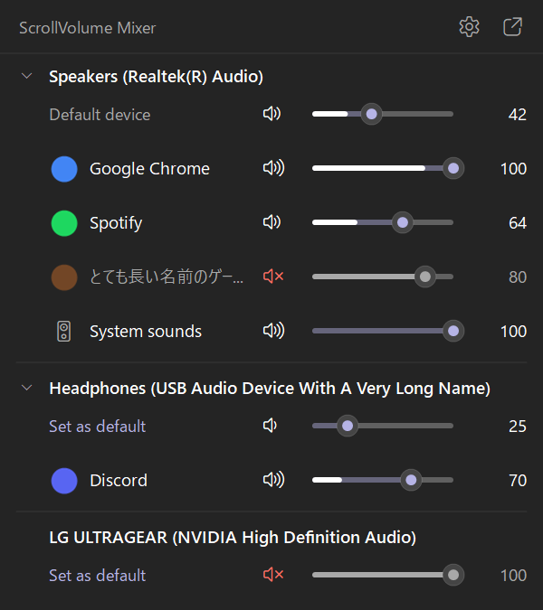
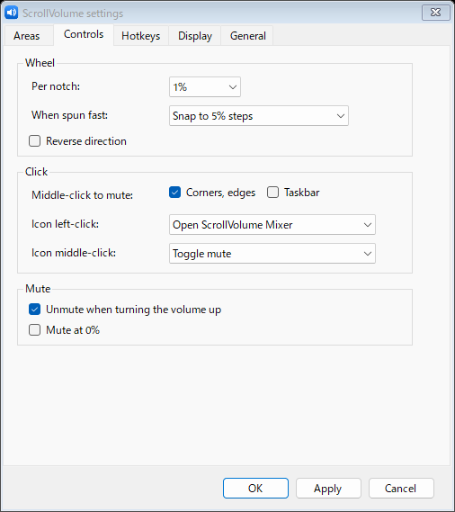

# ScrollVolume

**English** | [日本語](README.ja.md)

Change the volume on Windows by turning the mouse wheel over a screen corner, a screen edge, the taskbar or the tray icon.
The tray icon shows the current volume as a number.

[](https://github.com/megane2501h/ScrollVolume/releases/latest/download/ScrollVolume.zip)

https://github.com/user-attachments/assets/0e24d7d6-f7a7-41c6-be84-343fe5196cc1



## Features
- **Wheel anywhere at the screen border** – corners, edges, the taskbar or the tray icon. No need to aim for a tiny slider.
- **Fine and fast** – turn slowly for 1% steps; spin fast to jump in 5% steps (37 → 40 → 45 → 50%).
- **Middle-click to mute.**
- **ScrollVolume Mixer** – every playback device and every app playing sound in one panel, with level meters so you can see where the sound is coming from. Switch the default device with one click.
- **Hotkeys** – volume up / down, toggle mute, open the mixer, next playback device.
- **Game-friendly** – ignores the mouse and hides the volume bar while a full-screen game is running (hotkeys still work).
- **Light and dark** – follows the Windows theme. Japanese and English UI.
- **Small and portable** – a single ~220 KB `.exe`. No installer, no extra runtime.

## Download and run
1. Download **[ScrollVolume.zip](https://github.com/megane2501h/ScrollVolume/releases/latest/download/ScrollVolume.zip)** from the [latest release](https://github.com/megane2501h/ScrollVolume/releases/latest).
2. Extract it to a folder you can write to (for example `Documents\ScrollVolume`). Settings are saved next to the `.exe`.
3. Run `ScrollVolume.exe`. The volume appears in the tray.

> **"Windows protected your PC"?** The `.exe` is not code-signed, so SmartScreen may warn you the first time.
> Click **More info → Run anyway**. You can also [build it yourself](#build) from the source.

**Requirements:** Windows 10 or 11 (uses the .NET Framework 4.x that ships with Windows).

## Usage
| Where | Action | Result |
|---|---|---|
| Corners, edges, taskbar, tray icon | Wheel | Change the volume |
| Corners, edges | Middle-click | Mute / unmute |
| Tray icon | Left-click | Open the ScrollVolume Mixer |
| Tray icon | Middle-click | Mute / unmute |
| Tray icon | Right-click | Menu (volume, mute, playback device, settings, …) |

### ScrollVolume Mixer
- Wheel over a row to change that device's or app's volume; middle-click to mute it.
- **Set as default** switches the default playback device.
- The button at the top right turns the pop-up into a normal window that you can resize and keep on top.

## Settings
Right-click the tray icon → **ScrollVolume settings**.



- **Areas** – which corners and edges react, how wide they are, and whether the taskbar needs a modifier key (Ctrl / Shift / Alt).
- **Controls** – amount per notch, behavior when spun fast, reverse direction, middle-click and tray-icon click actions.
- **Hotkeys** – click a box and press the keys.
- **Display** – tray icon style (number / number on tile / bar), text color, the volume bar.
- **General** – start with Windows, run as administrator, game detection, language.

Settings are stored in `ScrollVolume.ini` next to the `.exe`.

**Run as administrator:** Windows does not pass mouse input from administrator apps (Task Manager, some games) to normal apps. Turn this on if the wheel stops working over such windows. ScrollVolume registers a Task Scheduler task so it can start elevated without a UAC prompt every time.

## Uninstall
1. In the settings, turn off **Start with Windows** and **Run as administrator** (this removes the startup entry and the scheduled task).
2. Exit ScrollVolume from the tray menu and delete its folder.

## Build
```powershell
.\build.ps1
```
Uses `csc.exe` from the .NET Framework 4.x that comes with Windows – nothing else to install.
If ScrollVolume is running, build to another file: `.\build.ps1 -Out .\out\ScrollVolume.exe`.

### Tests
```powershell
Start-Process .\ScrollVolume.exe -ArgumentList '--test','shots' -RedirectStandardOutput test.txt -Wait -NoNewWindow; Get-Content test.txt -Encoding utf8
```
Also writes screenshots of the UI to the `shots` folder.

UI wording is listed in [TERMS.md](TERMS.md) (Japanese).

## License
[MIT](LICENSE)
